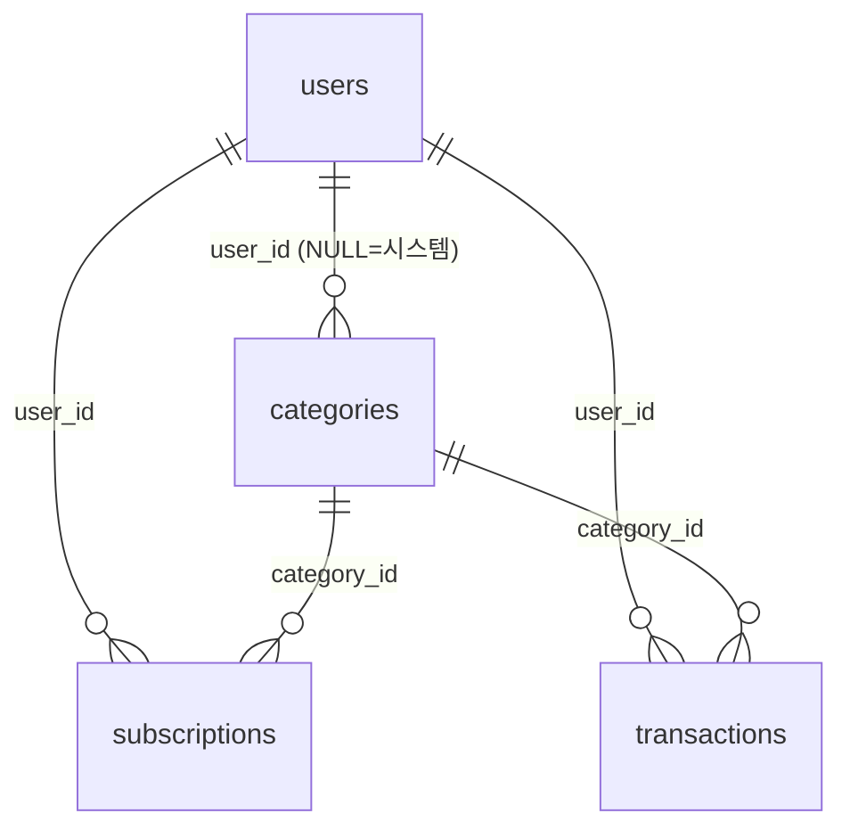

# DB 설계 — EC2 내부 MariaDB

- 기준: `PRD.md` v3.2(AGENTS.md 기준 문서), `backend/app/models.py`, `docs/ai-infra.md`, `PLAN.md`
- 대상: EC2의 MariaDB 한 대. FastAPI만 `127.0.0.1:3306`으로 접속한다.
- 테이블 생성: B의 `python -m app.init_db`(SQLAlchemy `create_all` + 기본 카테고리 시드). 이 문서의 SQL은 **참조·검증용**이고 `backend/`는 수정하지 않는다.
- 이 문서의 SQL·권한·백업 명령은 MariaDB 11.8.6(로컬 WSL, 임시 인스턴스)과 Python 3.14.4에서 실행해 확인했다. EC2에 설치되는 버전은 설치 후 `mariadb --version`으로 다시 확인한다.

## 1. 파일

| 파일 | 용도 | 실행 주체 |
|---|---|---|
| `db/00_init_database.sql` | DB 생성, 앱 계정 두 개에 권한 부여 (비밀번호 없음) | 관리자(`sudo mariadb`) |
| `db/01_schema_reference.sql` | `models.py`와 같은 DDL. `create_all` 결과 비교, 복원 테스트용 | 비교·테스트 시 |
| `db/02_seed_categories.sql` | 기본 카테고리 13개(재실행 안전). B의 시드와 같은 목록 | `init_db`를 못 쓸 때의 비교·복구용 |

## 2. ERD

정기결제는 **목록 관리용**이며 거래와 연결되지 않는다(AGENTS.md 4번, `models.py` 주석).



## 3. 테이블과 제약

공통: InnoDB, `utf8mb4` / `utf8mb4_unicode_ci`. 금액은 원 단위 `INT`. `DATE`는 KST 날짜, `DATETIME`은 UTC(앱이 채움, DB 기본값 없음).

| 테이블 | 주요 컬럼 | 키·인덱스 | 제약 |
|---|---|---|---|
| `users` | `email`, `password_hash` | PK `id`, UNIQUE `email` | 이메일 중복 거부 |
| `categories` | `user_id`(NULL=시스템), `name`(30), `type` | PK, 인덱스 `user_id` | FK→users, `type IN ('INCOME','EXPENSE')` |
| `transactions` | `user_id`, `type`, `amount_krw`, `occurred_on`, `category_id`, `merchant`, `memo`, `updated_at` | PK, 인덱스 `(user_id, occurred_on)`, `category_id` | FK 2개, `type` CHECK, `amount_krw >= 1` |
| `subscriptions` | `user_id`, `name`(120), `category_id`, `amount_krw`, `billing_cycle`, `billing_anchor_date`, `memo` | PK, 인덱스 `user_id`, `category_id` | FK 2개, `billing_cycle IN ('WEEKLY','MONTHLY','YEARLY')`, `amount_krw >= 1` |

- **월별 조회·집계:** `(user_id, occurred_on)` 인덱스가 거래 목록, 월 합계, 6개월 막대 차트의 범위 조건을 받는다.
- **삭제 동작:** 모든 FK는 기본(RESTRICT)이다. 카테고리·사용자 삭제 기능이 없고, 정기결제와 거래는 서로 참조하지 않아 정기결제를 지워도 거래에 영향이 없다.
- **같은 이메일:** collation이 대소문자를 구분하지 않아 `A@x.com`과 `a@x.com`은 같은 값으로 거부된다.

### DB가 강제하지 못하는 규칙

| 규칙 | 담당 |
|---|---|
| 거래 `type`과 카테고리 `type` 일치, 정기결제 카테고리는 `EXPENSE` | 앱(B). 다른 테이블 컬럼과의 비교라 단순 FK·CHECK로 불가 |
| 카테고리는 본인 것 또는 시스템 것만 사용, 모든 쿼리에 `user_id` 조건 | 앱(B). `smoke.sh`가 사용자 격리를 검증한다 |
| 사용자별 카테고리 이름 중복 | 앱(B). `user_id`가 NULL인 시스템 카테고리는 UNIQUE가 NULL을 구분하므로 DB로 막기 어려움 |

## 4. `create_all` 결과와의 일치 확인

`db/01_schema_reference.sql`을 별도 DB에 적용해 `init_db`가 만든 테이블과 `SHOW CREATE TABLE` 출력을 비교했고, 네 테이블 모두 동일했다. 모델이 바뀌면 이 파일을 함께 갱신한다. 비교 방법:

```bash
sudo mariadb -e "CREATE DATABASE ledger_ref_check CHARACTER SET utf8mb4 COLLATE utf8mb4_unicode_ci"
sudo mariadb ledger_ref_check < db/01_schema_reference.sql
for t in users categories transactions subscriptions; do
  diff <(sudo mariadb ledger_db -N -e "show create table $t\G" | sed 's/ AUTO_INCREMENT=[0-9]*//') \
       <(sudo mariadb ledger_ref_check -N -e "show create table $t\G" | sed 's/ AUTO_INCREMENT=[0-9]*//') && echo "$t 동일"
done
sudo mariadb -e "DROP DATABASE ledger_ref_check"   # 이 임시 DB만 삭제. ledger_db는 건드리지 않는다
```

## 5. 서버 설정 (T07)

`bind-address = 127.0.0.1` 확인(`docs/ai-infra.md`: `/etc/mysql/mariadb.conf.d/50-server.cnf`). 문자셋은 DB 생성 시 `utf8mb4`로 지정하므로 서버 기본값은 바꾸지 않아도 된다. 적용 후:

```bash
sudo ss -ltnp | grep 3306        # 127.0.0.1:3306 만 보여야 함
```

- `mariadb-secure-installation`(또는 동등한 정리)으로 익명 사용자와 `test` DB, 원격 root를 제거한다. 임시 인스턴스에서 `test` DB와 `test_%` DB에 모든 계정(PUBLIC)이 쓰기 권한을 갖는 기본값을 확인했다.
- 연결 URL의 호스트는 `127.0.0.1`로 두되, 서버가 이를 `localhost`로 해석하므로 **계정을 두 개** 만든다(아래).

## 6. 계정·권한

| 계정 | 접속 | 권한 |
|---|---|---|
| `root` | 서버 안 소켓(`sudo mariadb`)만 | 관리·스키마 변경·백업·복원 |
| `app_user`@`localhost`, `app_user`@`127.0.0.1` | FastAPI (같은 비밀번호) | `ledger_db.*`에 `SELECT, INSERT, UPDATE, DELETE, CREATE, ALTER, INDEX, REFERENCES`만 |

- `docs/ai-infra.md`의 권한을 따랐다. `DROP`, `GRANT OPTION`, `*.*` 권한은 없다. `ALTER`는 `create_all`에는 필요 없지만 스키마 변경을 앱 계정으로 해야 할 때를 위해 포함되어 있다. 줄이려면 `ALTER`를 회수한다.
- 앱 계정 생성은 비밀번호가 쉘 기록에 남지 않게 `sudo mariadb`의 대화형 프롬프트에서 직접 입력한다. 비밀번호는 환경 파일(권한 600)에만 두고 Git·채팅에 남기지 않는다.
- 스키마 변경이 필요하면 `ALTER TABLE`로 반영한다(`create_all`은 기존 테이블을 바꾸지 않는다). 운영 데이터는 임의로 DROP하지 않는다.

## 7. 실행 순서 (T07, T09)

```bash
# 1) 관리자로 앱 계정 두 개 생성(대화형, <DB_PASSWORD>는 직접 입력, 영숫자 위주 권장)
sudo mariadb
#   MariaDB> CREATE USER 'app_user'@'localhost' IDENTIFIED BY '<DB_PASSWORD>';
#   MariaDB> CREATE USER 'app_user'@'127.0.0.1' IDENTIFIED BY '<DB_PASSWORD>';
#   MariaDB> EXIT;

# 2) DB 생성·권한 부여
sudo mariadb < db/00_init_database.sql

# 3) 앱 계정으로 접속 확인 (비밀번호 프롬프트)
mariadb -h 127.0.0.1 -u app_user -p ledger_db -e "SELECT 1"

# 4) 환경 파일 작성 후 테이블 생성 + 시드 (ai-infra.md 체크리스트 6번)
cd backend && set -a && . /etc/ledger/backend.env && set +a && python -m app.init_db
```

예상 결과: 3번이 `1`을 출력하고, 4번이 `default categories added: 13`을 출력한다. 재실행하면 `0`이다.

## 8. 백업·복원 (T18, `docs/ai-infra.md` 기준)

백업 파일에는 비밀번호 해시가 들어 있으므로 권한을 600으로 하고 저장소 밖(`~/backup`)에 둔다.

```bash
mkdir -p ~/backup && (umask 077 && sudo mariadb-dump --single-transaction --routines ledger_db > ~/backup/ledger_db_$(date +%Y%m%d_%H%M).sql)

# 복원은 운영 DB가 아닌 별도 DB에
sudo mariadb -e "CREATE DATABASE ledger_restore_test CHARACTER SET utf8mb4 COLLATE utf8mb4_unicode_ci"
sudo mariadb ledger_restore_test < ~/backup/ledger_db_<날짜>.sql

# 행 수 비교
for t in users categories transactions subscriptions; do
  sudo mariadb -N -e "SELECT '$t', (SELECT COUNT(*) FROM ledger_db.$t), (SELECT COUNT(*) FROM ledger_restore_test.$t)"
done
sudo mariadb -e "DROP DATABASE ledger_restore_test"   # 테스트 DB만 삭제. ledger_db는 절대 지우지 않는다
```

예상 결과: 네 테이블 모두 두 숫자가 같다. 백업 전 `df -h /`로 디스크 여유를 확인한다.

## 9. 로컬 검증 결과 (임시 MariaDB 11.8.6 + Python 3.14.4, 검증 후 삭제)

| 검증 | 결과 |
|---|---|
| `pip install -r backend/requirements.txt` (Python 3.14.4) | 성공 |
| `python -m app.init_db` 2회 | 테이블 4개 생성, 카테고리 13 → 0건 추가(재실행 안전) |
| 참조 DDL vs `create_all` 결과 | 네 테이블 `SHOW CREATE TABLE` 동일 |
| uvicorn 실행 후 `/api/health` | `{"status":"ok","db":"ok"}` |
| `backend/scripts/smoke.sh` | 51개 통과, 0개 실패 |
| 없는 `/api` 경로 | JSON `{"detail":"Not Found"}` 404 |
| `app_user`의 `DROP TABLE` | 거부 |
| `127.0.0.1`로 접속 | 서버가 `app_user@localhost`로 해석 → 두 계정 필요 |
| 백업(`--single-transaction --routines`) → 별도 DB 복원 | 행 수 일치 |

## 10. 알려진 한계

- 모든 데이터가 EC2 한 대에 있어 EC2 장애 시 DB도 함께 멈춘다. 복구는 `mariadb-dump` 백업에 의존한다.
- 관리형 자동 백업이 없다. 시연 전에 백업·복원을 직접 검증한다(T18).
- `smoke.sh`는 실행할 때마다 테스트 계정 2개와 개인 카테고리가 남는다(삭제 API 없음). EC2 시연 DB에서 실행했다면 시연 전에 정리한다(README "테스트" 섹션의 정리 SQL).
- 저장소의 `PRD.md`는 v3.0(RDS·자동 반영 기준)이라 AGENTS.md가 가리키는 v3.2와 다르다. 이 설계는 v3.2를 반영한 `models.py`를 따른다.
