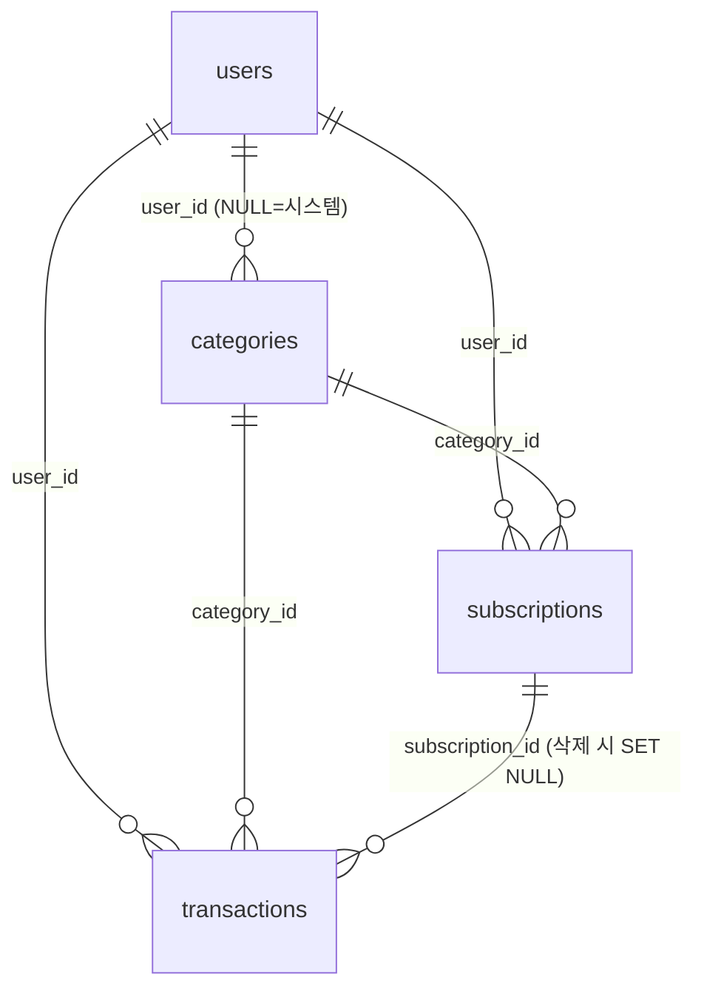

# DB 설계 — EC2 내부 MariaDB

- 기준: `PRD.md` 4장(테이블 정의), `PLAN.md` 2·T06·T07·T09·T18
- 대상: EC2의 MariaDB 한 대. FastAPI만 `127.0.0.1:3306`으로 접속한다.
- 테이블 생성 방법: B의 SQLAlchemy `create_all()`(PRD 4장). 이 문서의 SQL은 **참조·검증용**이다.
- 이름(`ledger_db`, `app_user`)은 PRD 예시이며 `PLAN.md` 2.2에서 확정되면 SQL 파일의 이름을 맞춘다.
- 이 문서의 DDL·제약·권한·백업 명령은 MariaDB 11.8.6(로컬 WSL, 임시 인스턴스)에서 실행해 확인했다. EC2의 Ubuntu 26.04에 설치되는 버전은 설치 후 `mariadb --version`으로 다시 확인한다.

## 1. 파일

| 파일 | 용도 | 실행 주체 |
|---|---|---|
| `db/00_init_database.sql` | DB 생성, 앱 계정 권한 부여 (비밀번호 없음) | 관리자(`sudo mariadb`) |
| `db/01_schema_reference.sql` | PRD 4장 기준 참조 DDL | `create_all` 결과 비교, 복원 테스트용 |
| `db/02_seed_categories.sql` | 기본 카테고리 13개 (재실행해도 중복 없음) | B의 시드 코드가 정식이면 비교·복구용 |

## 2. ERD



## 3. 테이블과 제약

공통: InnoDB, `utf8mb4` / `utf8mb4_unicode_ci`. 금액은 원 단위 `INT`. `DATE`는 KST 날짜, `DATETIME`은 UTC.

| 테이블 | 키·인덱스 | 제약 |
|---|---|---|
| `users` | PK `id`, UNIQUE `email` | 이메일 중복 거부 |
| `categories` | PK `id`, 인덱스 `user_id` | FK `user_id`→users, `type IN ('INCOME','EXPENSE')` |
| `subscriptions` | PK `id`, 인덱스 `user_id`, `category_id` | FK 2개, `amount_krw >= 1`, `billing_cycle IN ('WEEKLY','MONTHLY','YEARLY')` |
| `transactions` | PK `id`, 인덱스 `(user_id, occurred_on)`, `category_id`, UNIQUE `(subscription_id, due_date)` | FK 3개(`subscription_id`는 `ON DELETE SET NULL`), `type` CHECK, `amount_krw >= 1` |

설계 의도:

- **중복 방지:** `UNIQUE(subscription_id, due_date)`로 같은 결제일의 자동 거래가 두 번 생기지 않는다. 수동 거래는 두 컬럼이 모두 NULL이고, MariaDB는 NULL을 서로 다른 값으로 취급하므로 여러 건이 들어간다.
- **자동 거래 구분:** `due_date IS NOT NULL`이면 자동 반영 거래다. 정기결제를 삭제하면 `subscription_id`만 NULL이 되고 `due_date`는 남아, 삭제 뒤에도 출처를 구분할 수 있다.
- **월별 조회·집계:** `(user_id, occurred_on)` 인덱스가 거래 목록, 월 합계, 6개월 막대 차트의 범위 조건을 받는다. 실행 계획에서 이 인덱스를 쓰는 것을 확인했다.
- **카테고리 삭제 없음:** 카테고리 FK는 기본(RESTRICT)이다.
- **`updated_at`:** MariaDB의 `ON UPDATE`는 `CURRENT_TIMESTAMP`만 받고 서버 시간대(KST)를 따라 UTC 규칙과 어긋난다. 그래서 DB 자동 갱신을 쓰지 않고 앱이 UTC로 갱신한다.

### DB가 강제하지 못하는 규칙 (B의 앱 코드 담당)

| 규칙 | 이유 |
|---|---|
| 거래 `type`과 카테고리 `type` 일치 | 다른 테이블 컬럼과의 비교라 단순 FK·CHECK로 불가 |
| 카테고리는 본인 것 또는 시스템 것만 사용 | 소유권은 앱에서 모든 쿼리에 `user_id` 조건으로 확인(PRD 4.4) |
| 정기결제 카테고리는 `EXPENSE` | 위와 같음 |
| 사용자별 카테고리 이름 중복 | `user_id`가 NULL인 시스템 카테고리는 UNIQUE가 NULL을 구분하므로 DB로 막기 어려움. 시드는 `WHERE NOT EXISTS`로 중복을 피함 |
| 이메일 대소문자 | collation이 대소문자를 구분하지 않아 `A@x.com`과 `a@x.com`은 같은 값으로 거부되지만, 저장 시 소문자로 정규화하는 편이 안전함 |

## 4. B와 합의할 항목

- [ ] `updated_at`을 SQLAlchemy `onupdate`로 UTC 갱신
- [ ] 정기결제 동기화는 한 트랜잭션에서 해당 정기결제 행을 잠그고(`SELECT ... FOR UPDATE`) 결제일 거래를 만든 뒤 `synced_through`를 갱신. 동시 요청이 와도 UNIQUE가 마지막 방어선
- [ ] 등록일과 첫 결제일이 같은 경우 생성 여부(PRD 3.4는 "등록 시점 이전 결제분은 생성하지 않는다"까지만 정의)
- [ ] 기본 카테고리 시드를 `create_all` 직후 한 번 실행하되 재실행해도 안전하게
- [ ] `create_all`로 만든 실제 DDL을 `SHOW CREATE TABLE`로 `db/01_schema_reference.sql`과 비교해 차이를 합의
- [ ] 위 "DB가 강제하지 못하는 규칙"의 구현 위치

## 5. 서버 설정 (T07)

Ubuntu 기준 설정 파일 위치는 설치 후 확인한다(보통 `/etc/mysql/mariadb.conf.d/`). 별도 파일(예: `99-ledger.cnf`)로 둔다.

```ini
[mysqld]
bind-address            = 127.0.0.1
character-set-server    = utf8mb4
collation-server        = utf8mb4_unicode_ci
```

적용 후 `sudo systemctl restart mariadb`, `sudo ss -ltnp | grep 3306`에서 `127.0.0.1:3306`만 보여야 한다. DB 연결 URL의 호스트는 `localhost`가 아니라 `127.0.0.1`로 통일한다(계정이 `'app_user'@'127.0.0.1'`).

## 6. 계정·권한

| 계정 | 접속 | 권한 |
|---|---|---|
| `root` | 서버 안 소켓(`sudo mariadb`)만. 원격 접속 없음 | 관리·스키마 변경·백업·복원 |
| `app_user`@`127.0.0.1` | FastAPI | `ledger_db.*`에 `SELECT, INSERT, UPDATE, DELETE, CREATE, INDEX, REFERENCES`만 |

- `DROP`, `ALTER`, `GRANT OPTION`, `*.*` 권한은 주지 않는다. `create_all`은 `CREATE`로 충분하다.
- 스키마 변경이 필요하면 관리자가 `sudo mariadb`로 `ALTER TABLE`을 실행한다(PRD 4장: 운영 데이터 임의 DROP 금지).
- 앱 계정 생성은 비밀번호가 쉘 기록에 남지 않게 `sudo mariadb`의 대화형 프롬프트에서 직접 입력한다. 비밀번호는 환경 파일(권한 600)에만 두고 Git·채팅에 남기지 않는다.
- 필요하면 T09 이후 `CREATE`·`INDEX`를 회수해 더 줄일 수 있다.

## 7. 실행 순서 (T07, T09)

```bash
# 1) 관리자로 앱 계정 생성(대화형, <password>는 직접 입력)
sudo mariadb
#   MariaDB> CREATE USER 'app_user'@'127.0.0.1' IDENTIFIED BY '<password>';
#   MariaDB> EXIT;

# 2) DB 생성·권한 부여
sudo mariadb < db/00_init_database.sql

# 3) 앱 계정으로 접속 확인 (비밀번호 프롬프트)
mariadb -h 127.0.0.1 -u app_user -p ledger_db -e "SELECT 1"

# 4) 테이블 생성은 B의 create_all, 이후 시드(B의 코드 또는 아래 파일)
sudo mariadb ledger_db < db/02_seed_categories.sql
```

예상 결과: 3번이 `1`을 출력하고, 4번 이후 `SELECT type, COUNT(*) FROM categories GROUP BY type;`가 `EXPENSE 9`, `INCOME 4`를 보여준다.

## 8. 백업·복원 (T18)

백업은 root 소켓 인증으로 실행해 명령줄에 비밀번호가 나타나지 않게 한다. 백업 파일에는 비밀번호 해시가 들어 있으므로 권한을 600으로 하고 Git에 올리지 않는다(`backups/`는 `.gitignore` 대상).

```bash
# 백업 (디스크 여유 확인: df -h /)
mkdir -p backups && (umask 077 && sudo mariadb-dump --single-transaction ledger_db > backups/ledger_$(date +%Y%m%d_%H%M).sql)

# 복원은 운영 DB가 아닌 별도 테스트 DB에
sudo mariadb -e "CREATE DATABASE ledger_db_restore_test CHARACTER SET utf8mb4 COLLATE utf8mb4_unicode_ci"
sudo mariadb ledger_db_restore_test < backups/<백업파일>.sql

# 행 수 비교
for t in users categories subscriptions transactions; do
  sudo mariadb -N -e "SELECT '$t', (SELECT COUNT(*) FROM ledger_db.$t), (SELECT COUNT(*) FROM ledger_db_restore_test.$t)"
done
```

예상 결과: 네 테이블 모두 두 숫자가 같다. 확인 후 테스트 DB는 `sudo mariadb -e "DROP DATABASE ledger_db_restore_test"`로 지운다(**`ledger_db`는 절대 지우지 않는다**).

## 9. 로컬 검증 결과 (임시 MariaDB 11.8.6, 검증 후 삭제)

| 검증 | 결과 |
|---|---|
| 세 SQL 파일 실행, 참조 DDL 재실행 | 성공, 재실행 안전 |
| 시드 2회 실행 | 13건(지출 9, 수입 4), 중복 없음 |
| 이메일 중복 | 거부 |
| 금액 0, 잘못된 `type`·`billing_cycle` | CHECK로 거부 |
| 같은 `(subscription_id, due_date)` 재삽입 | 거부 |
| 수동 거래 여러 건(두 컬럼 NULL) | 허용 |
| 존재하지 않는 카테고리 | FK로 거부 |
| 정기결제 삭제 | 거래 유지, `subscription_id`는 NULL, `due_date` 보존 |
| `app_user`의 `DROP TABLE` | 거부 |
| 한글 카테고리 | 정상 저장·조회 |
| 월 범위 집계 쿼리 | `ix_transactions_user_occurred` 사용 |
| 백업 → 별도 DB 복원 | 행 수 일치(users 2, categories 13, transactions 3) |

검증 중 발견해 반영한 점: `updated_at`에 `ON UPDATE UTC_TIMESTAMP()`는 문법 오류라서 앱 갱신 방식으로 바꿨다.

## 10. 알려진 한계

- 모든 데이터가 EC2 한 대에 있어 EC2 장애 시 DB도 함께 멈춘다. 복구는 `mariadb-dump` 백업에 의존한다.
- 관리형 자동 백업이 없다. 시연 전에 백업·복원을 직접 검증한다(T18).
- `PRD.md` 파일은 아직 RDS 기준 문구(v3.0)가 남아 있다. 이 설계는 `PLAN.md`의 EC2 내부 MariaDB를 따른다. 4장의 테이블 정의에는 영향이 없다.
